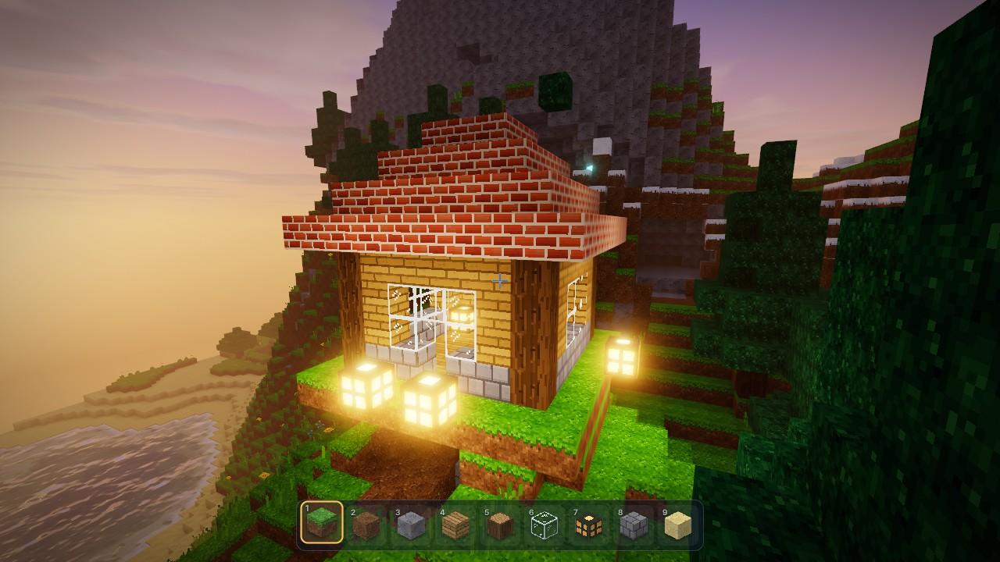
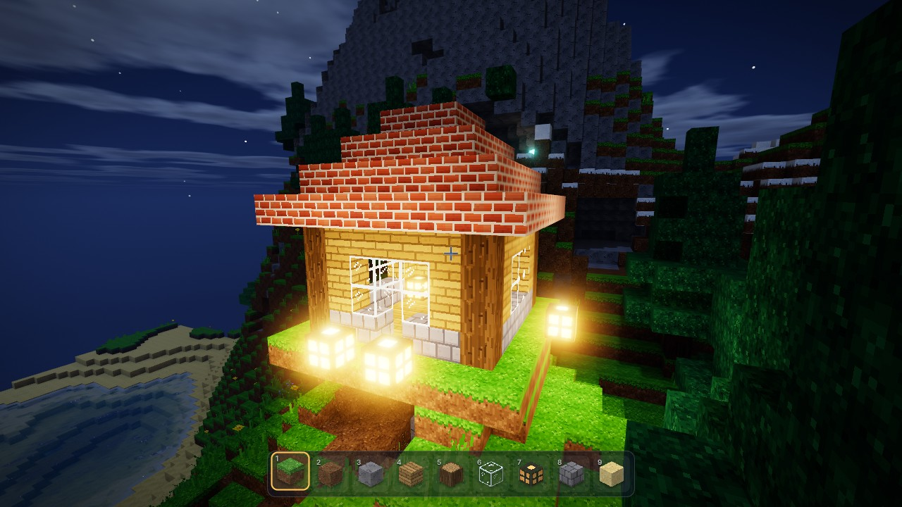
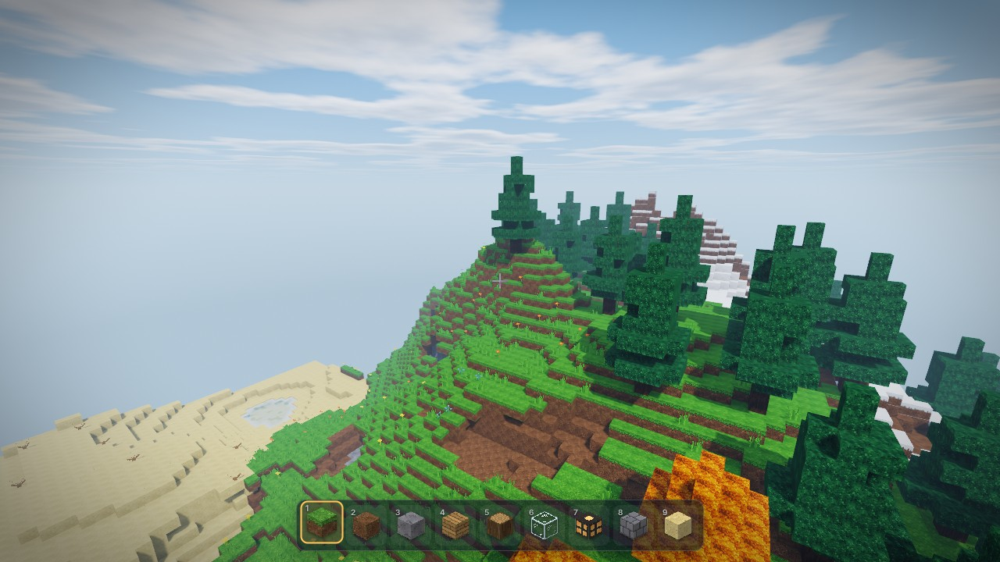
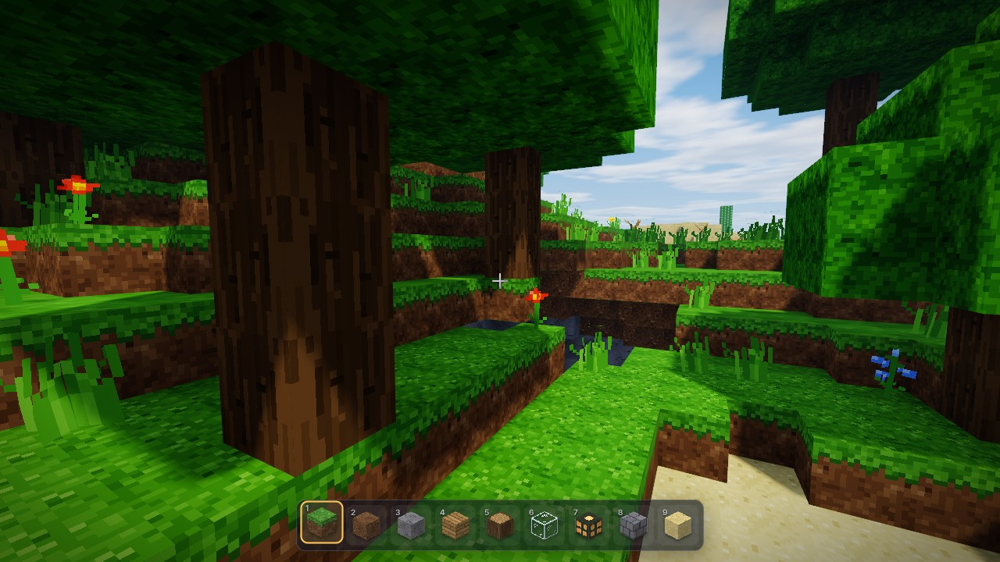
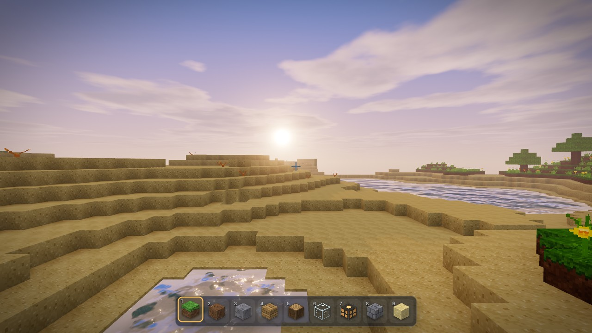
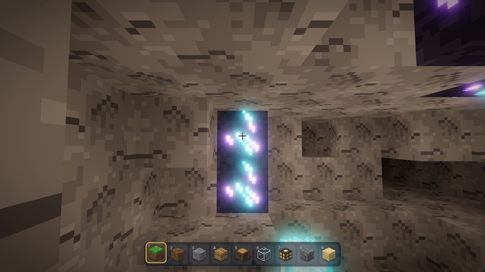
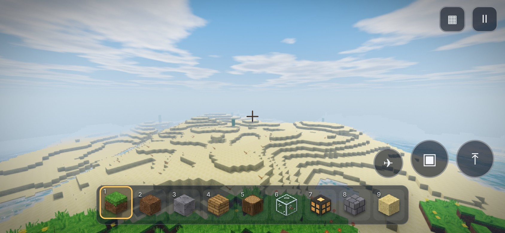
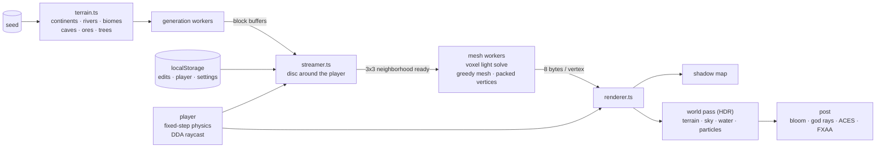

# Lumenwild

> An endless voxel world of light. Explore, dig and build across forests,
> deserts, snow peaks and glowing caves — in a browser tab, as a desktop
> app, or on a phone. No assets ship with it: every block, texture, cloud
> and sound is computed from one seed.

[](https://github.com/Vincent-P-essy/minecraft-clone/actions/workflows/ci.yml)
[](https://github.com/Vincent-P-essy/minecraft-clone/actions/workflows/pages.yml)
[](tsconfig.app.json)
[](LICENSE)

**▶ Play it now: [vincent-p-essy.github.io/minecraft-clone](https://vincent-p-essy.github.io/minecraft-clone/)**



|                                                                                   |                                                                          |
| --------------------------------------------------------------------------------- | ------------------------------------------------------------------------ |
|  |  |
|                   |           |
|              |  |

_All captured from the production build by `scripts/screenshot.mjs`, in
software WebGL — a real GPU draws the same frames, just faster._

## Playing

|                      | Desktop                                            | Touch                                        |
| -------------------- | -------------------------------------------------- | -------------------------------------------- |
| Move / jump / sprint | `WASD` (or arrows) · `Space` · `Shift`             | left-thumb joystick (push to edge to sprint) |
| Fly                  | double-tap `Space` or `F` · `Space` up · `C` down  | wing button · jump up · descend button       |
| Look                 | mouse (pointer lock)                               | drag the right half of the screen            |
| Break / place / pick | left click (hold to repeat) / right / middle click | tap to break · place button                  |
| Choose a block       | `1`-`9` or scroll · `E` opens all 32 blocks        | tap a slot · grid button opens all blocks    |
| Pause / stats        | `Esc` · `F3`                                       | pause button                                 |
| Share a world        | Worlds menu, or add `?seed=<number>` to the URL    | same                                         |

Keys are bound by position, so `WASD` is `ZQSD` on an AZERTY keyboard with
no configuration. If the browser refuses pointer lock the game switches to
drag-to-look on its own; if there is no WebGL2 at all it falls back to a
CPU raycaster and keeps playing.

Your position, the time of day, your hotbar and everything you built are
saved per world and restored when you come back. Settings (graphics tier,
view distance, field of view, sensitivity, volume, auto-jump…) apply live.

## What's in the world

- **Terrain**: continents and oceans, rivers that cut valleys to the sea,
  ridged mountains up to ~115 blocks, ten biomes (meadow, oak forest,
  autumn grove, pine forest, desert, tundra, mountain, snow peak, beach,
  ocean) with their own trees, plants and ground.
- **Underground**: caverns linked by winding tunnels, coal and gold veins,
  lumen crystals in cavern walls and glowing mushrooms on their floors —
  caves are lit from within before you bring a single lantern.
- **34 block types**, 32 of them placeable: stone and brick variants, three
  woods, planks, glass, ice, sand and sandstone, plants and flowers, and
  light sources.

## How it's drawn



- **Voxel lighting with no shared state.** Sky light and block light are
  solved per chunk over its 3×3 neighborhood. Light travels at most 15
  cells and the pad is 16, so the result inside the chunk is _exact_ — any
  chunk can be lit from scratch and agree with its neighbors along the
  border. That trades a little recomputation for never having a light
  seam or an incremental-update bug, and it parallelizes trivially.
- **Eight bytes a vertex.** Position, face, ambient occlusion, both light
  channels, tile, and flags are packed into two `uint32`s (down from 48
  bytes). Normals and texture coordinates are derived in the shader from
  the face index and the position itself, and every chunk draws with one
  shared index buffer.
- **Caves are drawn only when you could see them.** About 70% of a chunk's
  quads are cave walls no skylight reaches. They live in their own range
  of the same vertex buffer, drawn within a few chunks of the player and
  never into the shadow map; faces in total darkness also drop their
  ambient-occlusion pattern so they merge into large quads.
- **One sky, used three times.** The sky is an analytic gradient with a
  sun glow, evaluated by the sky dome, by the fog (distance fades into the
  colour that's actually behind it) and by the water (which reflects it).
  Clouds come from one tiling noise texture sampled by the dome, by the
  terrain for their moving shadows, and by the water for their reflection
  — so the three always line up.
- **A real light path.** Shadow-mapped sun and moon (texel-snapped,
  normal-offset bias, PCF), HDR rendering, bloom, god rays, ACES tone
  mapping. Water has Fresnel reflections, sliding ripples, depth-tinted
  shallows and shore foam. Emissive texels are flagged in the texture's
  alpha, so a lantern's glass glows and its iron frame doesn't.
- **Four graphics tiers.** _Low_ draws straight to the screen with no
  extra full-screen pass at all — that's the one for weak phones.
  _Medium_ adds the HDR chain and a small shadow map; _High_ and _Ultra_
  add MSAA, god rays and larger shadow maps. On top of the tier, a
  controller watches frame time and steps the render scale to stay fluid.
- **Motion that doesn't depend on the frame rate.** Physics runs at a fixed
  120 Hz and the camera interpolates between the last two steps, so
  movement is identical at 30, 60 or 144 Hz and a late frame isn't a
  stutter.
- **Zero art, zero audio files.** 41 textures are painted in code from a
  seeded PRNG (the hotbar icons are little isometric cubes rendered from
  them). Every sound — footsteps per material, digging, splashes, wind,
  birdsong by day and crickets by night — is synthesized with Web Audio.

## Platforms

One build, three shells:

- **Web / PWA** — `npm run build`. Installable from the browser; a
  generated service worker precaches the build, so it boots and plays
  offline.
- **Desktop** — [`desktop/`](desktop), an Electron shell. The page runs
  sandboxed and context-isolated with no Node integration; files are served
  from a private `app://` scheme with path-traversal checks and a strict
  Content-Security-Policy; navigation and permission requests are denied.
- **Android / iOS** — [`mobile/`](mobile), Capacitor wrapping the same
  build in a native WebView.

```sh
# desktop
npm run build:native && cd desktop && npm ci && npm start     # run it
npm run dist                                                  # installers in desktop/release

# android (needs the Android SDK)
npm run build:native && cd mobile && npm ci
npx cap add android && npm run android:apk
```

[`docs/shipping.md`](docs/shipping.md) covers what stands between these
builds and a store listing: signing, store requirements, and the
non-technical checklist.

## Development

```sh
npm ci
npm run dev          # local dev server
npm run check        # lint, format, types, 325 offline tests
npm run build        # production bundle

npm run build && npx vite preview --port 4173 &
npm run e2e          # 40 end-to-end checks in headless Chromium
node scripts/screenshot.mjs   # regenerate the README gallery
```

Everything interesting is testable without a browser: terrain determinism
and its layering invariants, light propagation (down shafts, under roofs,
through leaves and water, across chunk borders), mesher output down to
winding order and the surface/cave split, collision and flight, the
day/night model's continuity, the generated textures' alpha conventions,
and settings and saves against corrupt or hostile payloads.

On top of that, `scripts/visual-check.mjs` plays the _built_ game in
headless Chromium with software WebGL — no GPU needed, so it runs in CI.
Each scenario gets its own browser context, like a different player on a
different device: mouse and keyboard with pointer lock, pointer lock
refused (drag-look fallback), no WebGL at all (CPU raycaster), a phone
with only a touchscreen, every graphics tier compiling and rendering,
inventory, flight, settings and saves surviving a reload, and the service
worker booting the game with the network cut. What was verified, and where
it wasn't possible to verify, is recorded in
[`docs/verification.md`](docs/verification.md).

## Limits

- It's a creative sandbox: no survival mode, crafting, mobs or
  multiplayer.
- Water is still: it has depth, reflections and swimming, but breaking a
  dam doesn't flood anything.
- Block light is one channel, so a cyan crystal and an amber lantern cast
  the same warm light.
- The CPU fallback renderer trades fidelity for universality: flat-shaded
  blocks, no plants or glass, a short view distance.
- Frame rates on real phones and GPUs haven't been measured from this
  repository's CI — the tiers and the adaptive scale are designed for
  them, and the low tier is deliberately cheap, but treat performance on
  a given device as something to test, not a promise.

## License

[MIT](LICENSE) — © Vincent Plessy
